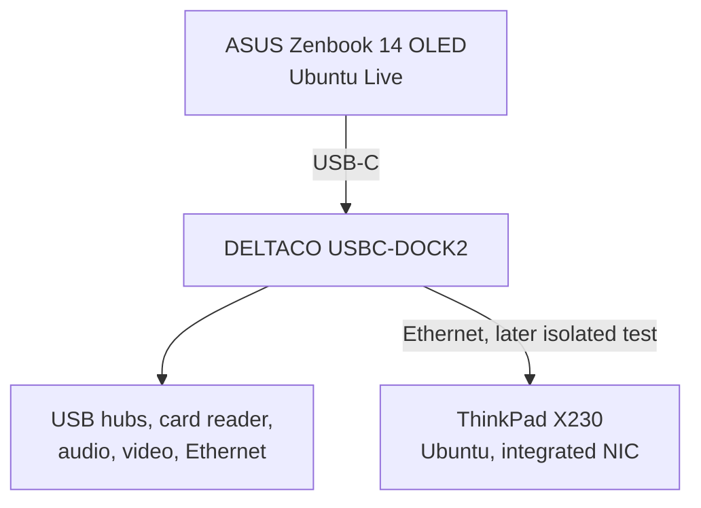

# DELTACO USBC-DOCK2: USB-C Dock Security Analysis

**Type:** Independent Blue Team / DFIR / hardware security learning project  
**Dates:** 18–19 October 2026  
**Target:** DELTACO USBC-DOCK2 (11-in-1 USB-C dock)  
**Environment:** Ubuntu 26.04.1 Live on an ASUS Zenbook 14 OLED; Ubuntu on a Lenovo ThinkPad X230 for the isolated Ethernet test

## Why I did this

I wanted to see what a normal-looking USB-C dock actually exposes to an operating system. A dock can contain several USB devices behind its ports, and some of them—HID, mass storage or network interfaces—can look suspicious if they are taken out of context.

I bought the dock sealed through a normal retail channel. I had no initial evidence that it was malicious. My goal was not to prove that it was safe, but to learn how to **establish a baseline, investigate changes and explain the findings from evidence**.

The main questions were:

- Which USB devices, interfaces and drivers appear when the dock is connected?
- Can I explain the new devices using the dock's expected features?
- Does a new keyboard, mouse, storage device or network interface appear unexpectedly?
- What happens when I test the ports one at a time?
- What does the dock's Ethernet interface actually do on an isolated link?

## Lab setup

I started with the Zenbook booted from a live USB, with the Windows installation left unused. The dock was connected **without** USB peripherals, memory cards, a monitor, an Ethernet cable or a USB-C PD charger. Wi-Fi and Bluetooth were disabled for the initial tests.

After documenting the dock alone, I added functions one at a time. Ethernet was examined later on a separate test link between the Zenbook and the ThinkPad.

## What I found

### USB enumeration

Comparing the before/after USB snapshots showed six new VID:PID pairs during the first dock-only connection:

| VID:PID | Identified function | Linux driver |
|---|---|---|
| `2109:2817` | VIA Labs USB 2.0 hub | `hub` |
| `2109:0817` | VIA Labs USB 3.0 hub | `hub` |
| `1a40:0101` | Terminus USB 2.0 hub | `hub` |
| `2537:1081` | Norelsys NS1081 card reader | `usb-storage` |
| `0bda:8153` | Realtek RTL8153 Ethernet interface | `r8152` |
| `2109:8817` | VIA Labs USB Billboard | No bound driver recorded |

The card reader appeared as a mass-storage-class device even when no card was inserted. That made sense once I correlated the block devices with the USB topology and kernel messages. A storage class alone is not an indicator of compromise.

### HID, audio and display

- The input-device snapshots taken before and after the **dock-only** connection were identical: no new input device was recorded in those snapshots.
- A Logitech mouse receiver was detected when I deliberately plugged in a mouse later. That HID device was expected.
- A C-Media `0d8c:0014` USB audio interface included a HID interface. Its inspected report descriptor contained consumer-control usages such as volume and mute, rather than a keyboard usage page. That supports a multimedia-control explanation, not a claim that all BadUSB-style behavior was ruled out.
- HDMI and DisplayPort were tested separately using Linux DRM connector states. Some display-related kernel warnings were also recorded and remain a limitation of the assessment.

### Ethernet and packet captures

The Realtek interface was identified through the `r8152` driver. A 1000 Mbit/s full-duplex link was observed during the working Ethernet test, and ARP plus ICMP communication succeeded in both directions without packet loss in the performed ping tests.

I captured traffic from **both** machines and compared the results:

| Protocol | Zenbook capture | ThinkPad capture |
|---|---:|---:|
| ARP | 8 | 8 |
| ICMP | 16 | 16 |
| IGMP | 2 | 2 |
| mDNS | 32 | 20 |
| **Total** | **58** | **46** |

Both IPv4 captures contain the request/reply traffic for the two four-packet ICMP tests. The captures overlap, so their packet counts should not be added together as if they represent independent network events. The different mDNS counts are recorded, but their exact cause was not established.

The ThinkPad snapshot recorded **17 RX packets, 31 TX packets and zero errors/drops in the checked counters**. The checked Zenbook Ethernet error counters were also zero. These are point-in-time observations, not long-term reliability results.

The initial `first.pcap` files contained no captured frames. This does **not** prove that there was no traffic outside their capture windows.

## Assessment

**In the features tested, I did not observe behavior indicating malicious activity.** The USB devices could be related to expected dock functions, and the captured Ethernet traffic contained the ARP, ICMP, IGMP and mDNS traffic described in the technical report.

This is a bounded observation, **not a certification that the dock is secure**. In particular:

- USB-C Power Delivery was not tested.
- The firmware and physical circuit board were not examined.
- The available USB and HID captures do not cover every possible transient behavior.
- Display-related kernel warnings were not fully root-caused.
- Network captures and interface statistics cover limited test windows.

I used three labels in my notes: **FACT** (supported observation), **ASSESSMENT** (interpretation) and **UNKNOWN** (not resolved). That separation became one of the most useful parts of the exercise.

## Tools and methods

`lsusb`, `lsusb -t`, `usb-devices`, `lsblk`, `ip`, `ethtool`, `journalctl`, `udevadm`, USB/HID descriptors, `tcpdump`, Wireshark/`tshark`, SHA256 hashing, and before/after snapshot comparison.

The exact commands, constraints and case-specific interpretations are documented in Finnish:

- [Technical DFIR report (FI)](docs/technical-report-fi.md)
- [Repeatable USB-C device investigation guide (FI)](docs/investigation-guide-fi.md)

## What I learned

My biggest takeaway was that **device context matters**. A HID interface or a mass-storage class may deserve investigation, but it is not a finding of malicious activity by itself. I also learned why it is important to record the baseline before changing anything and why captures from two endpoints must be compared carefully.

I would follow the same sequence for another unknown USB peripheral: isolate the environment, record the baseline, connect only the target, investigate one change at a time, preserve the evidence and report what the data supports. If I repeated this project, I would add a more systematic USB event capture and a separate PD analysis with suitable equipment.

## Evidence and public documentation

The original PCAPs, logs and compressed evidence archives are retained separately from this public repository. I did **not** include raw captures or identifiable host metadata in this GitHub project folder. The tables above are results extracted from the local evidence; the reports describe the evidence types and limitations.

This is a personal learning project, independent of the cyber defence exercise work documented elsewhere in this portfolio.
