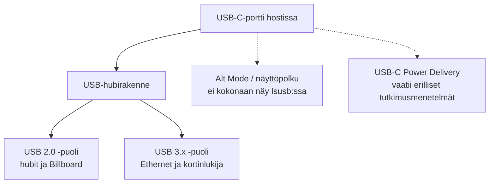
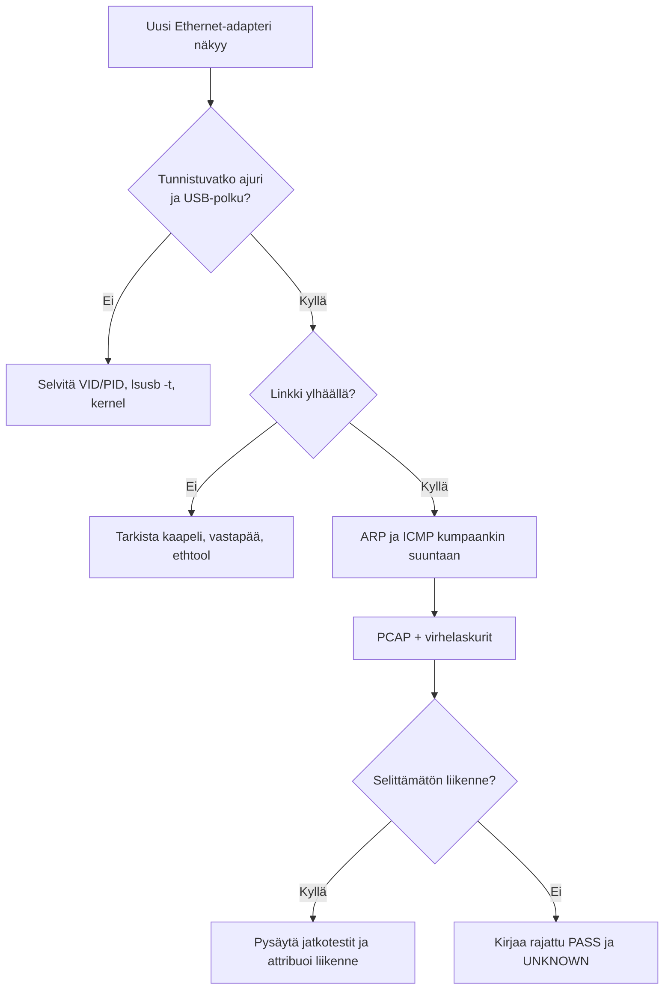

# USB-C-telakan tutkiminen Linuxilla – oma DFIR-työohje ja oppimateriaali

**Raportti 03: toistettava tutkimusopas**  
**Versio:** 3.0 / 19.10.2026  
**Esimerkkilaite:** DELTACO USBC-DOCK2 11-in-1  
**Kenelle:** opiskelijalle, joka haluaa osata tutkia seuraavan USB-laitteen itse  
**Lähtökohta:** alkuperäisestä tutkimuksesta kerätyt USB-, näyttö-, audio- ja verkkotiedostot

Tämä on tarkoituksella erilainen dokumentti kuin tekninen loppuraportti. Raportti 02 vastaa kysymykseen **mitä Deltaco-telakasta havaittiin**. Tässä käyn läpi **miten vastaava tutkimus rakennetaan, miksi komennot valitaan ja kuinka tulokset tulkitaan**. Komennot ovat tulevia tutkimuksia varten annettuja esimerkkejä, ellei niitä nimenomaisesti sidota aiemman Deltaco-kokeen tallenteisiin. En väitä, että jokaista tässä esitettyä komentoa olisi käytetty alkuperäisessä kokeessa täsmälleen samalla syntaksilla.

---

## Osa I – mitä fyysisestä USB-laitteesta pitää ymmärtää?

### 1. USB-C ei kerro vielä, mitä laitteen sisällä tapahtuu

USB-C on liitintyyppi. Sen kautta voi kulkea esimerkiksi tavallista USB-dataa, virransyöttöä (Power Delivery, PD) ja DisplayPort Alternate Mode -signaalia. Moniporttinen telakka ei yleensä näy käyttöjärjestelmälle yhtenä laitteena, vaan joukkona eri komponentteja.

Deltacon ensikytkentä on tästä hyvä esimerkki: sen USB-laiteluettelossa näkyi **kolme hubia, kortinlukija, Realtek-verkkoadapteri ja Billboard-laite**. Kuuden laitteen ilmestyminen ei siis yksin tarkoita kuutta ylimääräistä tai epäilyttävää toimintoa.



**Opittava perusasia:** laiteluettelo ei ole täydellinen kaavio USB-C-liittimen kaikista sähköisistä ja signaalitason ominaisuuksista.

### 2. Viisi käsitettä, jotka on osattava erottaa

| Käsite | Mitä kertoo? | Mitä ei yksin kerro? |
|---|---|---|
| **VID/PID** | Laitteen ilmoittama valmistaja- ja tuotetunniste | Onko firmware aito tai turvallinen |
| **USB class** | Rajapinnan ilmoittama toiminnallinen tyyppi, esim. HID tai Mass Storage | Onko laite haitallinen |
| **Interface** | Yhden fyysisen USB-laitteen erillinen toiminto | Että jokainen interface olisi oma fyysinen laite |
| **Kernel driver** | Minkä Linux-ajurin host sitoi rajapintaan | Onko laite tai ajuri virheetön |
| **USB topology/path** | Mihin hubiin/porttiin laite näkyy kytkeytyneenä | Laitteen tarkka piirilevyrakenne |

Esimerkiksi **HID ei tarkoita automaattisesti näppäimistöä**, eikä **Mass Storage automaattisesti tarkoita USB-tikulle piilotettua ohjelmaa**. Nämä ovat tutkittavia luokituksia, eivät itsessään havaittuja hyökkäyksiä.

### 3. Millaista näyttöä haen?

Tutkimuksen peruslogiikka on:

1. Määrittele kysymys: ”Ilmestyykö telakan mukana odottamaton syöttölaite?”
2. Kirjaa **baseline**, eli tila ennen kytkentää.
3. Muuta yhtä asiaa kerrallaan.
4. Kirjaa uusi tila ja tapahtumaloki.
5. Vertaa juuri syntynyttä muutosta alkuperäiseen tilaan.
6. Etsi laitteelle fyysinen selitys ja Linux-ajuri.
7. Merkitse, mikä on varmaa, mikä tulkintaa ja mikä jäi avoimeksi.

Kun tämä ketju toimii, jatkotutkimus perustuu yksittäiseen löydökseen eikä pelkkään epäilyyn.

---

## Osa II – turvallinen testikone ja työtila

### 4. Ympäristön valinta

Alkuperäisessä Deltaco-tutkimuksessa käytin Zenbookin omaa USB-C-porttia, koska toisella testikoneella ei ollut siihen soveltuvaa liitäntää. Ensimmäinen tutkimus tehtiin **Ubuntu Desktop Live USB** -ympäristössä (*Try Ubuntu*), eikä Windows 11:tä käynnistetty telakan ensimmäisiä havaintoja varten.

Miksi en lähtisi ensisijaisesti virtuaalikoneella liikkeelle? Fyysinen host hallitsee USB-C:n ja osan laite-enumeroinnista ennen kuin tavallinen USB-passthrough välittää yksittäisen USB-laitteen virtuaalikoneelle. VM voi silti sopia joihinkin jatkoanalyyseihin, mutta ei korvaa host-tason ensimmäistä tutkimusta.

**Ennen testiä:**

- Varmuuskopioi tärkeät tiedostot.
- Tarkista Ubuntu-ISO:n alkuperä ja SHA256 ennen boot-tikun luomista.
- Käynnistä Live USB:ltä; älä valitse käyttöjärjestelmän asennusta.
- Älä avaa tai mounttaa sisäisen Windows-levyn osioita.
- Älä suorita levymuutoksia kuten `mkfs`, `dd` tai levyn osiointia.
- Asenna tarvittavat työkalut ennen offline-vaihetta; katkaise sen jälkeen Wi-Fi, Bluetooth ja Ethernet.
- Telakassa ei ole aluksi muita laitteita eikä PD-virtalähdettä.

**Keskeytysehdot:** uusi selittämätön keyboard-HID, näkyvästi automatisoitu komentosyöttö, odottamaton aktiivinen tallennuslaite tai muu poikkeama, jota ei pysty nopeasti selittämään. Tällöin pysäytä normaali funktionaalinen testaus, säilytä havainnot ja analysoi kyseinen muutos erikseen.

### 5. Estä automaattinen mounttaus

Ubuntu GNOME -työpöydällä voidaan Live-istunnossa asettaa:

```bash
gsettings set org.gnome.desktop.media-handling automount false
gsettings set org.gnome.desktop.media-handling automount-open false

gsettings get org.gnome.desktop.media-handling automount
gsettings get org.gnome.desktop.media-handling automount-open
```

**Mitä tämä tekee?** Ensimmäiset kaksi komentoa muuttavat kyseisen käyttäjän GNOME-asetuksia. Jälkimmäiset lukevat asetuksen arvon ja auttavat varmistamaan, että molemmat ovat `false`.

**Rajoitus:** tämä ei ole yleinen koko järjestelmän mount-kielto. Tarkkaile edelleen `lsblk`-tuloksen `MOUNTPOINTS`-kenttää ja mahdollisia udev-/kernel-tapahtumia. Älä irrota tai pysäytä järjestelmän omaa Live USB -asemaa.

### 6. Tee tallennuskansio

Jos olet Ubuntu Liven omassa käyttäjähakemistossa:

```bash
mkdir -p ~/dock-test/{baseline,after,logs,pcap,notes}
cd ~/dock-test
```

`mkdir -p` luo hakemistot tarvittaessa. Komento ei muuta sisäisiä levyjä, **kun käyttäjähakemisto on Live-ympäristössä**. Testin aikana työtilassa syntyneet tiedostot voivat kadota Live-istunnon sammuessa, joten siirrä ne lopuksi erikseen hallitusti ulkoiselle tallennusmedialle ja laske tiivisteet.

### 7. Tarkista ympäristö ennen telakkaa

```bash
uname -a
lsb_release -a
lsblk -o NAME,TRAN,SIZE,TYPE,FSTYPE,MOUNTPOINTS
ip -br link
```

**Mistä katson?**

- `uname -a`: kernel ja arkkitehtuuri.
- `lsb_release -a`: Ubuntu-julkaisun tiedot, jos työkalu on asennettu.
- `lsblk`: mitä levyjä on jo olemassa; mikä on boot-tikku ja mikä sisäinen NVMe/HDD.
- `ip -br link`: mitä verkkorajapintoja on ennen telakkaa.

Älä olettaisi, että sisäinen levy on aina `nvme0n1` tai boot-tikku aina `sda`. Nämä nimet pitää **tunnistaa sen hetkisestä koneesta**, ei muistista.

---

## Osa III – baseline ja ensimmäinen kytkentä

### 8. Baseline: mitä ilman telakkaa näkyy?

```bash
lsusb > baseline/lsusb.txt
lsusb -t > baseline/usb-tree.txt
usb-devices > baseline/usb-devices.txt
ip -br link > baseline/network.txt
lsblk -o NAME,SIZE,TYPE,FSTYPE,MOUNTPOINTS > baseline/block.txt
cat /proc/bus/input/devices > baseline/input.txt
```

`>` kirjoittaa komennon tulosteen nimettyyn tiedostoon. Se **ylikirjoittaa** saman tiedoston, joten käytä uusia kansioita tai tiedostonimiä, jos tarvitset monta testikertaa.

**Miksi kaikki kuusi?**

- `lsusb` vastaa ”mitkä USB-laitteet”.
- `lsusb -t` vastaa ”missä ne ovat ja mikä ajuri niitä käyttää”.
- `usb-devices` näyttää lisää rajapintatietoja.
- `ip` paljastaa mahdollisen uuden verkkokortin.
- `lsblk` paljastaa mahdollisen kortinlukijan tai tallennuslaitteen.
- `/proc/bus/input/devices` paljastaa syöttölaitteet, joita en halua tunnistaa vasta vahingossa tapahtuvan näppäinpainalluksen jälkeen.

### 9. Reaaliaikaiset lokit

Avaa kaksi terminaali-ikkunaa **ennen** telakan kytkemistä:

Terminaali A:

```bash
sudo journalctl -kf
```

Terminaali B:

```bash
sudo udevadm monitor --kernel --udev --property
```

`-k` rajaa journalin kernel-viesteihin ja `-f` seuraa uusia tapahtumia. `udevadm monitor` näyttää laitehallinnan tapahtumia ja niiden ominaisuuksia. Lopetus on `Ctrl+C`.

Jos haluat tallentaa seuraamisen myöhempää raporttia varten, käytä erillisiä komentoja:

```bash
sudo journalctl -kf | tee logs/kernel-follow.txt
sudo udevadm monitor --kernel --udev --property | tee logs/udev-follow.txt
```

**Tärkeä yksityiskohta:** nämä tuottavat tavallisesti jatkuvaa tulostetta. Varmista, että tallenne on käynnissä ennen kytkentää ja että lopetat sen vasta havaintoikkunan jälkeen. Jos käytät `sudo`-komentoa pipe-rakenteessa, huomaa, että `tee` toimii tämän esimerkin käyttäjällä ja tallentaa käyttäjähakemistoon.

### 10. Kytke telakka – ei vielä mitään muuta

Ensimmäisessä vaiheessa vain telakan USB-C-host-kaapeli kytketään testikoneeseen. Älä liitä samalla hiirtä, SD-korttia, audiolaitetta, näyttöä tai verkkokaapelia.

Heti enumeroinnin jälkeen:

```bash
lsusb > after/lsusb.txt
lsusb -t > after/usb-tree.txt
usb-devices > after/usb-devices.txt
ip -br link > after/network.txt
lsblk -o NAME,SIZE,TYPE,FSTYPE,MOUNTPOINTS > after/block.txt
cat /proc/bus/input/devices > after/input.txt
```

Näiden tiedostojen sisältö on tutkimuksen tärkein ensimmäinen tulos.

### 11. Vertaa ennen ja jälkeen

```bash
diff -u baseline/lsusb.txt after/lsusb.txt
diff -u baseline/usb-tree.txt after/usb-tree.txt
diff -u baseline/network.txt after/network.txt
diff -u baseline/block.txt after/block.txt
diff -u baseline/input.txt after/input.txt
```

`diff -u` näyttää poistetut rivit `-`-merkillä ja lisätyt `+`-merkillä. **Tämä ei tee tiedostoihin muutoksia.**

**DELTACO-esimerkki:** USB-listaan ilmestyi kuusi uutta VID/PID-paria, mutta alkuperäisen `before-input.txt`- ja `after-input.txt`-tiedoston sisältö ei muuttunut. Silloin oikea johtopäätös ei ole ”laite on todistettu puhtaaksi”, vaan:

> Ensikytkennän kahdessa input-snapshotissa ei havaittu uutta syöttölaitetta. USB-laiteluettelon uudet rajapinnat selittyvät telakan tunnistetuilla toiminnoilla.

### 12. Kerää laitekohtaiset yksityiskohdat

Kun uusi VID/PID löytyy, tarkenna sitä:

```bash
lsusb -d 0bda:8153
sudo lsusb -v -d 0bda:8153
usb-devices
```

**Mitä lippu tarkoittaa?** `-d VID:PID` rajaa USB-laitteen tunnisteella; `-v` näyttää yksityiskohtaiset deskriptorit. `sudo` voi olla tarpeen kaikkien tietojen lukemiseen.

Deltacon Realtekistä havaittiin `0bda:8153`. Se näkyi USB-topologiassa `Vendor Specific Class` -rajapintana, johon `r8152` oli sidottu. Tämä on konkreettinen esimerkki siitä, miksi USB-luokkaa ja Linux-ajuria on katsottava **yhdessä**.

### 13. Avaa oikea jatkokysymys

Jos näkyy uusi laite:

| Löydös | Mitä tarkistan seuraavaksi? |
|---|---|
| HID Keyboard | `input`-tallenne, USB-polku, tapahtumaloki, tarkoitettu fyysinen toiminto; keskeytä normaali testaus, jos selitys puuttuu |
| HID Mouse | Oliko hiiri tai vastaanotin juuri kytketty? |
| USB Mass Storage | Onko telakassa kortinlukija? Onko media sisällä? Onko mountpointia? |
| CDC/USB-verkkoadapteri | Ajuri, MAC, verkkotopologia, liikenne vasta eristetyssä vaiheessa |
| Serial/ACM | Selittääkö dokumentoitu toiminto sarjaportin? |
| Billboard | Alt Mode -deskriptorit; älä tee PD-johtopäätöstä vain laitteen läsnäolosta |

---

## Osa IV – ominaisuustestit hallitusti

### 14. Lisää yksi toiminto ja ota uusi snapshot

Käytin Deltaco-projektissa seuraavaa ajatusta: ensin telakka yksin, sitten USB-A, SD, microSD, audio, HDMI ja DisplayPort ja vasta myöhemmin Ethernet. PD jätettiin tutkimatta.

Jokaiselle uudelle vaiheelle voi tehdä oman alihakemiston, esimerkiksi:

```bash
mkdir -p ~/dock-test/steps/01-mouse
lsusb > ~/dock-test/steps/01-mouse/lsusb.txt
lsusb -t > ~/dock-test/steps/01-mouse/tree.txt
cat /proc/bus/input/devices > ~/dock-test/steps/01-mouse/input.txt
```

**Tee näistä uudelleenotos ennen kuin lisäät seuraavan laitteen.** Muuten joudut päättelemään jälkikäteen, mikä komponentti aiheutti minkäkin muutoksen.

### 15. Esimerkki: hiiri ja väärä BadUSB-hälytys

Deltacon ensimmäisen kytkennän input-tiedostot olivat identtiset. Erillinen hiirikoe lisäsi Logitech-vastaanottimen `046d:c542` ja laitteen `Logitech Wireless Receiver Mouse`.

Siis **HID kyllä ilmestyi, mutta vasta silloin kun hiiri oli kytketty**. Tämä on tärkeä DFIR-periaate: löydöksen ajallinen yhteys testivaiheeseen voi ratkaista sen, onko kyse odotetusta muutoksesta.

Jos vastaava näppäimistö ilmestyisi *ilman* kytkettyä näppäimistöä tai tiedossa olevaa selittävää laitetta, jatkaisin tutkimusta enkä normaalisti liittäisi enää muita lisälaitteita.

### 16. Esimerkki: kortinlukija näyttää massamuistilta

Deltacossa Norelsys `2537:1081` esittäytyi `usb-storage`-rajapintana. Ilman kortteja ilmestyi kaksi 0 tavun lohkolaitetta. Kortin lisääminen tuotti 59,5 Gt exFAT-osion. SD-kokeessa se oli `sdc1`, microSD-kokeessa `sdb1`.

Mitä opin tästä?

- **USB Mass Storage** on odotettu tapa toteuttaa kortinlukija.
- **0 B** ilman mediaa ei tarkoita piilotettua 0 tavun haitallista levyä.
- `sdb`/`sdc` voi vaihtua, joten laitekirjaimeen ei voi perustaa tunnistusta.
- `lsblk`-snapshotissa puuttuva mountpoint osoittaa vain, ettei kyseisessä snapshotissa näy mounttausta.

Kopioitava tarkistus:

```bash
lsblk -o NAME,PATH,TRAN,SIZE,TYPE,FSTYPE,MOUNTPOINTS
```

**Älä mounttaa tuntematonta mediaa vain tarkistaaksesi mitä siellä on.** Ensimmäinen vaihe on aina passiivinen tunnistus.

### 17. Esimerkki: audiolaitteessa on HID

Deltacon audiotestin C-Media `0d8c:0014` sisälsi audio-rajapintoja ja yhden HID-rajapinnan. HID-raportin Consumer Usage Page liittyi äänenvoimakkuuden säätöön ja mykistykseen, eikä tarkastetussa raportissa ollut keyboard-käyttösivua.

Jatkossa kysyn audiolaitteesta:

1. Mihin USB-polkuun HID on liitetty?
2. Onko samalla USB-laitteella myös audio-interfaceja?
3. Mitä HID:n *report descriptor* sanoo käyttösivuista?
4. Näkyykö syötettyjä tapahtumia, joita fyysinen toiminto ei selitä?

Hyödyllisiä komentoja:

```bash
lsusb -t
cat /proc/bus/input/devices
sudo lsusb -v -d 0d8c:0014
```

Älä kutsu jokaista HID:tä BadUSB:ksi. Mutta älä myöskään väitä pelkän deskriptorin perusteella kaikkia ajonaikaisia tapahtumia tarkastetuiksi.

### 18. Näyttötesti ja USB-C:n ”piilossa” oleva puoli

Deltacon HDMI-kokeessa DRM:n `card1-DP-9/status` muuttui `connected`-tilaan ja DP-kokeessa vastaavasti `card1-DP-8/status`. Kummankin EDID tallennettiin. Tämä on näyttöliitännän tunnistumishavainto.

Toistettavan kokeen komennot:

```bash
for f in /sys/class/drm/*/status; do echo "$f:$(cat "$f")"; done
```

Tee tämä **ennen näyttöä** ja **sen jälkeen**, ja tallenna tulosteet eri tiedostoihin. Koneen sisäinen eDP-näyttö näkyy yleensä jo alussa `connected`-tilassa. Älä erehdy pitämään sitä telakan uutena ulkoisena näyttönä.

Deltacon kernel-lokissa oli `ucsi_acpi`-tilakyselyvirhe sekä `amdgpu`-ajurin LTTPR-ilmoituksia ja varoitus. Raportissa näitä ei jätetty pois, mutta niistä ei myöskään tehty päätelmää haitallisesta laitteesta.

**Seuraavan tutkimuksen lisämittaus:** tarkista näytön todellinen resoluutio, virkistystaajuus, kuvan vakaus sekä toistuuko sama virhe ilman telakkaa. Näin erotetaan hostin tai näytönohjaimen mahdollinen ongelma telakasta.

### 19. USB Billboard ei ole USB-C PD -testi

Deltacon Billboard-deskriptorissa lukee `Alternate Mode configuration successful`. Se kertoo ilmoitetusta Alt Mode -tilasta. Se **ei** kerro, mitä jännitettä, virtaa tai sopimusviestejä Power Deliveryn kautta neuvoteltiin.

Jos seuraavassa laitteessa tavoitteena on USB-C PD -analyysi, tarvitaan erillinen tutkimussuunnitelma ja mittalaitteisto. Älä aloita kotitekoisella PD-injektiolla tai kytkennällä, jonka jännitetasoista et ole varma.

---

## Osa V – Ethernet kahden Linux-koneen välillä

### 20. Miksi en kytkisi verkkokaapelia heti?

Ethernet on aktiivinen rajapinta. Hostin oma DHCP, IPv6, mDNS tai muu verkko-ohjelmisto voi lähettää paketteja, jotka eivät johdu telakan poikkeavasta toiminnasta. Jos verkko otetaan käyttöön vasta USB-laitteiden tunnistamisen jälkeen, on helpompaa erottaa **telakan olemassaolo**, **verkkoadapterin toiminta** ja **hostin oma liikenne**.

Deltaco-testi tehtiin kahden Linux-koneen eristetyssä testiverkossa. Seuraavassa mallissa `192.0.2.1` ja `192.0.2.2` ovat sama dokumentaatiokäyttöön varattu TEST-NET-1-osoitepari, joka näkyy alkuperäisessä pakettiliikenteessä. Älä käytä sitä yrityksen verkossa tai internetiin kytketyssä tuotantoympäristössä.

### 21. Tunnista verkkorajapinnat

Molemmilla koneilla:

```bash
ip -br link
ip -br addr
```

Tutkimusaineistossa ThinkPadin Ethernet-rajapinta on `enp0s25`, telakan kautta kytketyn Zenbookin `enx00e04ce790b9`.

**Miksi tämä on tärkeää?** Jos ajat `tcpdump`in vahingossa Wi-Fi-rajapintaan, et tarkastele telakan Ethernetiä. Jos taas käytät väärää nimeä `ip addr` -komennossa, saatat muuttaa väärän verkon asetuksia.

Seuraavissa esimerkeissä käytetään shell-muuttujaa, jotta rajapinnan vaihto tehdään yhdessä kohdassa:

```bash
IFACE=enp0s25
ip -s link show dev "$IFACE"
```

ThinkPadissa tämä on dokumentoidun kokeen mukainen esimerkki. Zenbookissa määrittelisit `IFACE`-muuttujan omaksi `enx...`-nimekseen.

### 22. Staattiset IP-osoitteet vain eristetyssä testissä

Jos ympäristö on varmasti kaksi erillistä testikonetta ilman muuta verkkoa ja osoitteet halutaan tehdä käsin, malli on:

Zenbookilla:

```bash
IFACE=enx00e04ce790b9
sudo ip link set dev "$IFACE" up
sudo ip addr add 192.0.2.1/24 dev "$IFACE"
```

ThinkPadilla:

```bash
IFACE=enp0s25
sudo ip link set dev "$IFACE" up
sudo ip addr add 192.0.2.2/24 dev "$IFACE"
```

`ip addr add` lisää osoitteen olemassa olevaan rajapintaan. Se ei tarkoita DNS:n, oletusyhdyskäytävän tai internetin määrittämistä. Tällaiset komennot **muuttavat aktiivista verkkokonfiguraatiota**; niitä ei käytetä huomaamatta tavallisessa työ- tai kotiverkossa. Jos osoite on jo lisätty, toista `add` vain jos tiedät, mitä olet tekemässä.

Nämä ovat **uusintatutkimuksen mallikomennot**. Alkuperäinen PCAP todistaa käytetyt IP-osoitteet, mutta ei yksin kerro, millä täsmällisellä komentorivillä ne asetettiin.

### 23. Tarkista linkki ja ajuri

```bash
sudo ethtool -i "$IFACE"
sudo ethtool "$IFACE"
sudo ethtool -S "$IFACE"
ip -s link show dev "$IFACE"
```

| Komento | Mitä etsin? |
|---|---|
| `ethtool -i` | `driver`, mahdollinen `firmware-version`, `bus-info` |
| `ethtool` | `Speed`, `Duplex`, `Link detected` |
| `ethtool -S` | Adapterin omat virhelaskurit |
| `ip -s link` | RX/TX-paketit, tavut, virheet, pudotukset |

**Tärkeä tapaus Deltacosta:** yksi Zenbookin `ethtool`-tilannekuva sanoi `Link detected: no` ja `Speed: Unknown!`. Toinen snapshot sanoi `UP,LOWER_UP`. Tekijä vahvisti muussa vaiheessa 1000 Mbit/s Full Duplex -linkin. En yhdistä näitä väkisin yhdeksi samanaikaiseksi tulokseksi. Jos tekisin kokeen uudestaan, tallentaisin `date -Is` ennen jokaista mittausta.

### 24. ARP ja ICMP – mitä pitäisi näkyä?

Kun linkki on kunnossa, testaa yhteys **molemmista suunnista**.

Zenbookilta:

```bash
ping -c 4 192.0.2.2
```

ThinkPadilta:

```bash
ping -c 4 192.0.2.1
```

`-c 4` lähettää neljä Echo Request -pakettia ja lopettaa. `ping` kertoo lopuksi, montako lähetettiin, vastaanotettiin ja mikä oli häviöprosentti.

**Mitä kaappauksissa todella näkyi?** Molemmissa Deltacon Ethernet-PCAP:eissa oli kaksi testisarjaa: ThinkPadilta Zenbookille 4 Echo Request + 4 Reply ja toiseen suuntaan 4 + 4. ICMP:n `identifier`-arvot olivat `27784` ja `13809`, sequence-numerot kummassakin 1–4.

Löysin siis suoraan pakettiliikenteestä vastausparit. Tekijän ilmoittama **0 % packet loss** on näiden tallenteiden kanssa yhteensopiva. Pidemmän ajan tai paljon suuremman kuormituksen häviöttömyyttä tästä ei voi päätellä.

ARP on edeltävä, erillinen kysymys: host tarvitsee paikallisen IPv4-naapurin MAC-osoitteen. Tutkimuksessa molemmat PCAP:t sisälsivät yhteensä **4 ARP Request + 4 ARP Reply** -pakettia.

### 25. Kaappaa liikenne niin, että löydät myös yllätykset

Aloita eristetyssä labrassa ilman tiukkaa protokollasuodatinta:

```bash
sudo tcpdump -i "$IFACE" -nn -s 0 -w pcap/ethernet-full.pcap
```

`-i` valitsee oikean verkkorajapinnan. `-nn` estää nimien/porttien muuntamisen näyttötulosteessa, `-s 0` pyytää kokonaiset paketit ja `-w` tallentaa ne PCAP-tiedostoon. Pysäytä tallenne `Ctrl+C`:llä.

**Miksi ei heti `icmp`-suodatinta?** Jos tallennan vain ICMP:n, en voi enää todeta, oliko samassa ajassa poikkeavaa DNS-, ARP- tai muuta liikennettä.

Ota pakettikaappaus mahdollisuuksien mukaan **molemmilla hosteilla** ja kirjaa aloitus-/lopetusaika. Älä muuta raakaa PCAP-tiedostoa analyysiä varten.

### 26. Analysoi PCAP sen tallentamisen jälkeen

Asenna/tarkista tarvittavat työkalut etukäteen. Jos `tshark` on käytössä:

```bash
tshark -r pcap/ethernet-full.pcap -q -z io,phs
tshark -r pcap/ethernet-full.pcap -Y 'arp || icmp || igmp || mdns'
tshark -r pcap/ethernet-full.pcap -Y 'icmp.type == 8'
tshark -r pcap/ethernet-full.pcap -Y 'icmp.type == 0'
```

Selitykset:

- `-r` lukee valmiin tiedoston eikä käynnistä verkkokaappausta.
- `-q -z io,phs` tuottaa protokollahierarkian tilastot.
- `-Y` on **display filter**: se valitsee näytettävät paketit, ei muuta lähde-PCAP:ia.
- ICMP type 8 tarkoittaa Echo Request ja type 0 Echo Reply (IPv4).

Voit tarkistaa myös, mitä koneet todella yrittivät tehdä:

```bash
tshark -r pcap/ethernet-full.pcap -T fields \
  -e frame.number -e frame.time_epoch \
  -e ip.src -e ip.dst -e _ws.col.Protocol
```

**Tärkeää:** nämä ovat opiskelun mallikomennot. Tässä raportissa käytetyt Deltacon lukumäärät tarkistettiin tallennettujen PCAP-tiedostojen rakenne- ja protokollakentistä, ei oletetusta `tshark`-ajohistoriasta.

### 27. Deltaco: Zenbookin ja ThinkPadin PCAP:t rinnakkain

| Asia | Zenbook | ThinkPad |
|---|---:|---:|
| `*-ipv4.pcap` koko | 6 312 tavua | 4 854 tavua |
| Kaikki kehykset | **58** | **46** |
| ARP | 8 | 8 |
| ICMPv4 | 16 | 16 |
| IGMP | 2 | 2 |
| mDNS | 32 | 20 |
| Aloitus (UTC) | 16:27:23 | 16:28:23 |
| Lopetus (UTC) | 16:39:30 | 16:39:30 |

**Mitä opettelisin tästä?** Ensimmäinen ajatus ei ole ”toinen kone hukkasi 12 pakettia”. Kaappaukset alkoivat eri aikaan, multicastin näkyvyys ja keräyspisteen näkökulma voivat vaikuttaa tuloksiin, eikä tallenne itsessään sisällä varmaa selitystä erolle. Molemmissa näkyvät tärkeimmät kaksi ICMP-testisarjaa.

mDNS-liikennettä oli kummassakin. Sen multicast-kohde on `224.0.0.251` ja UDP-portti 5353. Tutkimuksessa tämän portin paikalliseksi käyttäjäksi tunnistettiin Avahi. Älä kuitenkaan väitä, että PCAP yksin kertoo täsmällisen lähettäneen prosessin.

IGMP:n multicast-kohde oli `224.0.0.22`. Se on normaali protokollaluokka IPv4-multicastin hallintaan, mutta yksittäisen IGMP-paketin ”haitattomuus” ei perustu pelkkään nimeen vaan kokonaiskontekstiin.

### 28. Molemmat `first.pcap`-tiedostot olivat tyhjiä

Sekä `zenbook-first.pcap` että `thinkpad-first.pcap` ovat **24 tavua** ja sisältävät vain klassisen PCAP-otsakkeen. Paketteja on **0**.

Tämä todistaa, että **tiedostossa ei ole tallennettuja paketteja**. Se ei todista, että verkossa ei liikuttu, että liikennettä ei ollut muilla rajapinnoilla, tai että kaappaus olisi varmasti käynnistetty onnistuneesti oikeaan aikaan.

Hyvä DFIR-raportti säilyttää myös epäonnistuneelta näyttävän keräyksen ja kertoo rehellisesti sen arvon.

### 29. NIC-laskurit: nolla ei tarkoita ikuista virheettömyyttä

Deltacon aineistossa:

| Lähde | RX-paketit | TX-paketit | Tarkastetut virhe-/pudotuslaskurit |
|---|---:|---:|---|
| Zenbook / `r8152` | 29 | 31 | 0 |
| ThinkPad / `enp0s25` | 17 | 31 | 0 |

ThinkPadin tulosteessa myös `rx_crc_errors=0`, `rx_frame_errors=0` ja `collisions=0`. Nämä ovat **snapshot-lukuja**.

Mitä ne eivät sano? Ne eivät takaa, ettei myöhemmässä kuormituksessa synny virheitä. Niitä ei myöskään voi suoraan laskea yhteen PCAP-pakettien kanssa, koska eri väyläkerrokset, rajaukset ja mittaushetket eivät välttämättä ole samat.

### 30. Verkkotutkimuksen päätöspuu



---

## Osa VI – syvempi USB-analyysi ja evidenssin laatu

### 31. Milloin usbmon kannattaa ottaa käyttöön?

`lsusb`, `usb-devices` ja kernel-loki kertovat, **mikä laite ilmestyi**. `usbmon` auttaa tarkastelemaan USB-siirtoja tarkemmalla tasolla. Tämä voi olla hyödyllistä, jos laite lähettää yllättäviä raportteja, toimii vain hetkittäin tai USB-topologiassa on selittämätön rajapinta.

Valmisteleva tarkistus:

```bash
sudo modprobe usbmon
ls /sys/kernel/debug/usb/usbmon 2>/dev/null
```

Jos kyseinen debugfs-polku ei ole käytettävissä, se ei välttämättä tarkoita, ettei usbmon toimisi. Selvitä kernelin ja työkalujen tuki ennen jatkamista. Tarkista USB-bussit ensin `lsusb -t`:llä; vältä turhan laajaa kaappausta, koska mukana voi olla myös muita USB-laitteita.

Deltaco-aineistossa on `dock-usb-idle.pcapng`: kaksi usbmon-linkkityyppistä rajapintaa, **2 233 Enhanced Packet Block -tietuetta**, yhteensä 224 588 tavua. Tähän oppaaseen tehdyn tarkistuksen perusteella kaappauksen rakenteessa on tapahtumia, mutta **niiden siirtosisältöä ei ole kattavasti analysoitu**. En siis merkitsisi sitä ”puhtaaksi USB-kaappaukseksi” vain pakettimäärän vuoksi.

Lisätietoa: [Linux kernel – usbmon](https://docs.kernel.org/usb/usbmon.html).

### 32. CRC, SHA256 ja ”chain of custody”

SHA256 antaa tietylle tiedoston tavujonolle tiivisteen. Jos kopio ja alkuperäinen antavat saman SHA256-arvon, ne vastaavat toisiaan bittitasolla käytetyn tarkistusmenetelmän rajoissa. Tiiviste ei kuitenkaan kerro, oliko alkuperäinen keräys täydellinen tai onko laitteen antama tieto totta.

```bash
sha256sum tiedosto.pcap
sha256sum dock-analysis-backup.tar.gz
sha256sum -c deltaco-ethernet-zenbook-20261019.sha256
```

Varmista, että `.sha256`-tiedoston ilmoittama tiedostonimi löytyy samasta hakemistosta tai että käytät tarkoitukseen sopivaa polkua. `sha256sum -c` tarkistaa manifestissa olevat arvot tiedostojen nykyistä sisältöä vasten.

**DELTACO-esimerkki:** Zenbookin Ethernet-arkiston SHA256 on

```text
cd7d0cdb27850dafaaaeb427904105f09891bd74734a4d3ae1f81ef09a78e26b
```

Se vastasi toimitettua checksum-tiedostoa. Arkiston tallennus SanDisk-kortille ja uudelleenmounttauksen jälkeinen tarkistus tehtiin tutkimusvaiheessa. Myös ThinkPadin tallenteet on nyt saatu mukaan, ja niiden tiivisteet löytyvät raportista 02.

**Chain of custody** tarkoittaa tätä laajempaa säilytys- ja käsittelyketjua: kuka keräsi, milloin, mistä järjestelmästä, miten siirrettiin, miten pääsyä rajoitettiin ja mitä analyysikopioita syntyi. Tässä opiskelutyössä sitä ei voida väittää aukottomaksi.

### 33. Käytä aina raakaa evidenssiä, kun tarkistat raportin

Jos sinulla on Deltacon aineisto samassa hakemistossa:

```bash
tar -tzf dock-analysis-backup.tar.gz
tar -tzf deltaco-ethernet-zenbook-20261019.tar.gz
```

`tar -t` **listaa** arkiston sisällön; `-z` käyttää gzipia ja `-f` ottaa tiedostonimen seuraavasta argumentista. Näin voit tarkistaa arkiston sisällön purkamatta sitä.

Purkamista varten käytä erillistä työhakemistoa ja tutki ensin, ettei arkistossa ole poikkeavia suhteellisia polkuja tai symbolisia linkkejä:

```bash
mkdir -p ~/dock-test/evidence-copy
# Arvioi tar -tzf -tuloste ensin. Pura vasta sen jälkeen:
tar -xzf dock-analysis-backup.tar.gz -C ~/dock-test/evidence-copy
```

`-x` purkaa. Älä käsittele alkuperäistä evidence-arkistoa muokkaamalla sisäisiä tiedostoja; tee analyysi erotetusta kopiosta.

---

## Osa VII – havaintojen tulkinta käytännössä

### 34. FACT / ASSESSMENT / UNKNOWN: esimerkit

**Esimerkki A – uusi massamuistilaite**

- **FACT:** Linuxissa näkyi Norelsys `2537:1081` ja kaksi 0 B removable-laitetta ilman korttia.
- **ASSESSMENT:** se sopii SD/microSD-kortinlukijaan.
- **UNKNOWN:** pystyykö jokin harvinaisempi käyttötapa esittämään lisää rajapintoja, ellei niitä ole tutkittu.
- **Status:** PASS kortinlukijan rajatulle tunnistukselle.

**Esimerkki B – HID audiotestissä**

- **FACT:** C-Media `0d8c:0014`, audio- ja HID-rajapinta, Consumer Usage Page.
- **ASSESSMENT:** HID sopii audio-ohjaukseen eikä ole tässä testissä todettu näppäimistöinjektio.
- **UNKNOWN:** kaikki ajonaikaiset HID-tapahtumat.
- **Status:** PASS deskriptorin tulkinnalle; ei ”täysi HID-turvallisuustesti”.

**Esimerkki C – verkko ja PCAP**

- **FACT:** ThinkPadilla 46 pakettia ja Zenbookilla 58; molemmissa näkyivät vastaavat kaksisuuntaiset neljän pingin sarjat.
- **ASSESSMENT:** eristetyn linkin ARP- ja ICMP-yhteys toimi havaintoikkunassa.
- **UNKNOWN:** multicast-pakettimäärien eron täsmällinen syy ja liikenne myöhemmin.
- **Status:** PASS rajatulle toiminnalliselle verkkotestille.

**Esimerkki D – linkkivirhe kernelissä**

- **FACT:** `amdgpu` ilmoitti LTTPR-arvojen virheistä ja tuotti varoituksen.
- **ASSESSMENT:** näytön signaalipolussa tai ajurissa oli tutkittava diagnostiikkailmiö.
- **UNKNOWN:** virheen juurisyy ja vaikutus pitkäaikaiseen toimintavarmuuteen.
- **Status:** INVESTIGATE erilliselle näyttödiagnostiikalle; ei todennettu haittaohjelmaindikaattori.

### 35. Mitkä päätelmät olisivat liian vahvoja?

| Älä kirjoita näin | Kirjoita mieluummin näin |
|---|---|
| ”Telakka on täysin turvallinen.” | ”Tutkituissa ominaisuuksissa ei havaittu haitallisuuteen viittaavaa toimintaa.” |
| ”PCAP:ssa ei ole liikennettä, joten verkko oli hiljainen.” | ”24-tavuinen PCAP ei sisällä pakettitietueita; kaappauksen onnistumista ei voi tästä päätellä.” |
| ”Kaikki HID-laitteet ovat BadUSB:tä.” | ”HID-rajapinnan käyttötarkoitus pitää tulkita deskriptorin ja testikontekstin perusteella.” |
| ”0 virhettä tarkoittaa virheetöntä verkkokorttia.” | ”Tutkituissa virhelaskureissa oli nolla kyseisellä mittaushetkellä.” |
| ”Billboard todistaa PD:n toimivan.” | ”Billboard ilmoittaa Alt Mode -tiedot; PD jäi testaamatta.” |
| ”PCAP-laskurit ja NIC-pakettilaskurit pitää saada täsmäämään.” | ”Laskurit ja PCAP voivat kuvata eri havaintoikkunoita ja keräyskerroksia.” |

### 36. Yhden testin dokumentointipohja

Kopioi tämä uuden tutkimuksen muistioon ja täytä tiedot **heti testin jälkeen**:

```markdown
## TEST-XX – [mitä haluan selvittää?]

**Tarkoitus:**
**Ennen testiä:** [host, kernel, offline/linkkitila]
**Kytkentä:** [mitä lisättiin tai muutettiin]
**Komento/menetelmä:**
**Alkuperäinen tulostiedosto:**
**Tulos:**
**FACT:**
**ASSESSMENT:**
**UNKNOWN:**
**Status:** PASS / PARTIAL / FAIL / INVESTIGATE / NOT TESTED
**Seuraava vaihe:**
```

Pidä lokin aikaleimat ja kellon aikavyöhyke mukana, jos teet useita peräkkäisiä kaappauksia.

### 37. Pienet harjoitukset omasta Deltaco-aineistosta

**Harjoitus 1.** Katso `before-usb.txt` ja `after-usb.txt`. Laske uudet laitteet ja selitä jokaiselle fyysinen tai looginen toiminto. Tarkistus: kuusi uutta VID/PID-paria.

**Harjoitus 2.** Katso `before-input.txt` ja `after-input.txt`. Muuttuuko sisältö? Tarkistus: ei muutu. Mieti, mitä tämä todistaa ja mitä ei.

**Harjoitus 3.** Selitä miksi kahden `0 B` -levylaitteen esiintyminen ei ole tässä automaattinen löydös haitallisesta tallennustilasta.

**Harjoitus 4.** Lue `audio-hid-report.txt` ja selvitä, mikä on `Consumer Usage Page` ja mihin usage-arvot `e9`, `ea`, `e2` liittyvät.

**Harjoitus 5.** Tutki kaksi IPv4-PCAP:ia. Laske kummastakin ARP, ICMP ja mDNS, yhdistä Echo Request ja Reply `identifier`- ja `sequence`-arvoilla. Pohdi miksi 46 ja 58 pakettia ei tarkoita, että 12 pakettia olisi varmasti kadonnut telakan vuoksi.

**Harjoitus 6.** Vertaa `zenbook-linkinfo.txt` ja `zenbook-linkstats.txt`. Miksi et voi osoittaa kummastakaan yksin, että juuri sen tallennushetkellä linkki oli 1000 Mbit/s Full Duplex?

**Harjoitus 7.** Kirjoita yhdestä kernelin LTTPR-virheestä FACT, ASSESSMENT ja UNKNOWN ilman että kutsut sitä hyökkäykseksi.

**Harjoitus 8.** Mieti, millainen mittauslaite tai kontrollikoe tarvittaisiin USB-C Power Deliveryn arvioimiseksi. Älä toteuta vaarallista sähköistä testiä pelkän oppaan perusteella.

---

## Osa VIII – uusi tutkimus alusta loppuun

### 38. Toistettava etenemislista

- [ ] Tiedän tutkimuskysymykset ja fyysisen laitteen dokumentoidut ominaisuudet.
- [ ] Varmuuskopiot ja turvallinen käyttöympäristö ovat kunnossa.
- [ ] Live ISO on luotettavasta lähteestä ja tiiviste tarkistettu.
- [ ] Verkkoyhteydet on katkaistu ensimmäistä kytkentää varten.
- [ ] Automaattinen mounttaus on poistettu käytöstä ja tarkistettu.
- [ ] Ennen-tilanteesta on USB-, input-, block- ja verkkosnapshotit.
- [ ] Reaaliaikaiset kernel-/udev-lokit ovat käynnissä.
- [ ] Ensimmäinen kytkentä tehty ilman muita oheislaitteita.
- [ ] Jokaiselle uudelle USB-laitteelle on VID/PID, class, interface, driver ja toimintoselitys.
- [ ] Poikkeava HID tai tallennuslaite on selvitetty ennen jatkamista.
- [ ] Lisätoiminnot lisätty yksi kerrallaan, mittaus toistettu jokaiselle.
- [ ] Verkkotesti tehty vasta eristetyssä labrassa.
- [ ] PCAP:t tarkistettu molemmista päistä, eikä päällekkäisiä havaintoja summata.
- [ ] Ajuri- ja linkkivirhelaskurit talletettu.
- [ ] Tiedostoista on SHA256 ja analyysikopiot erotettu alkuperäisistä.
- [ ] Kaikki tulokset on merkitty FACT / ASSESSMENT / UNKNOWN.
- [ ] Avoimet kysymykset ovat näkyvissä lopputuloksessa.

### 39. Mitä opin tästä projektista?

Minulle tärkein menetelmällinen oppi on, että **havaintojen konteksti ratkaisee**. Sama HID-luokka voi tarkoittaa tarkoituksella kytkettyä hiirtä, audiolaitteen äänenvoimakkuussäätöä tai jotain, jonka vuoksi testi pitää keskeyttää. Sama USB Mass Storage -luokka voi tarkoittaa kortinlukijaa, vaikka mitään korttia ei vielä ole paikallaan.

Toinen tärkeä havainto tuli Ethernetistä. Kaappaukset molemmista päistä eivät olleet pakettimääriltään identtiset, mutta niiden ICMP-kyselyt ja -vastaukset vastasivat toisiaan. Sain vahvemman perustelun toimivalle yhteydelle kuin yhden koneen `ping`-tuloksesta – samalla opin, ettei PCAP-lukujen eroa voi automaattisesti kutsua verkkoviaksi.

Kolmas oppi liittyy raportointiin: **hyvä tutkimusraportti kertoo myös keskeneräiset osat**. USB-C Power Delivery jäi tekemättä, usbmonin sisältöä ei avattu kokonaan ja näyttöpuolen kernel-viesteille jäi avoin juurisyy. Niiden kirjaaminen ei heikennä tehtyä tutkimusta, vaan rajaa sen johtopäätökset oikein.

### 40. Seuraavat opiskeluteemat

1. **USB-deskriptorit ja USB device classes:** opettele erottamaan Device / Configuration / Interface / Endpoint -deskriptorit.
2. **HID report descriptor:** selvitä usage pages, report ID:t ja ero ilmoitettujen käyttösivujen ja oikean syöttöliikenteen välillä.
3. **usbmon + Wireshark:** opettele lukemaan control- ja interrupt-transferit rajatulta USB-bussilta.
4. **Ethernet- ja multicast-analyysi:** ARP, ICMP, IGMP, mDNS, DHCP ja IPv6 Neighbor Discovery.
5. **DFIR-evidenssin hallinta:** tiedostojen hajautusarvot, kellot, käsittelyketju ja analyysikopiot.
6. **USB-C Alt Mode ja PD:** opi teoriatasolla, mitä `lsusb` ei voi näyttää ja millaista laitteistoa oikea sähköinen tutkimus edellyttää.

Lähteet jatko-opiskeluun: Linuxin `man lsusb`, `man ip`, `man ethtool`, `man tcpdump`; [Linux usbmon](https://docs.kernel.org/usb/usbmon.html); [Wireshark User's Guide](https://www.wireshark.org/docs/wsug_html_chunked/) ja [tshark](https://www.wireshark.org/docs/man-pages/tshark.html).

**Projektin viimeinen dokumentointivaihe:** erillinen GitHub-portfolio vasta raporttien viimeistelyn jälkeen. Julkiseen julkaisuun suunnitellaan valikoidut, anonymisoidut löydökset; kaikkia raakoja PCAP- ja host-tietoja ei julkaista automaattisesti. Mahdollinen PDF-koonti voidaan tehdä portfolio-tekstin jälkeen.
