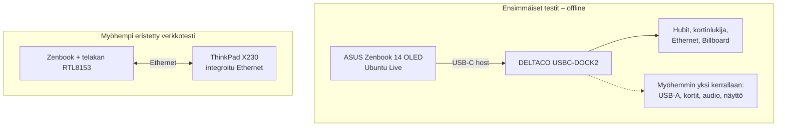
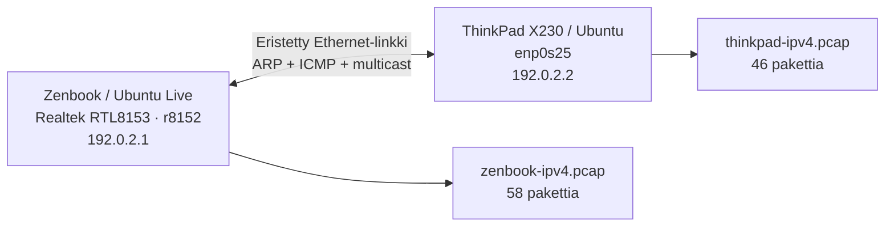

# DELTACO USBC-DOCK2 – USB-C-telakan tietoturvatutkimus

**Raportti 02: tekninen loppuraportti**  
**Versio:** 3.0 / 19.10.2026  
**Tutkimus:** 18.–19.10.2026  
**Näkökulma:** Blue Team, DFIR ja hardware security  
**Kohde:** DELTACO USBC-DOCK2, 11-in-1 USB-C -telakka  
**Dokumentin luonne:** opiskelutyö / rajattu tekninen tutkimus

> **Keskeinen tulos:** Tutkituissa ominaisuuksissa ei havaittu haitalliseen toimintaan viittaavaa käyttäytymistä. Tämä ei tarkoita, että telakka olisi todistettu kaikilta osin turvalliseksi. USB-C Power Delivery, firmware ja fyysisen elektroniikan tutkimus jäivät tekemättä.

## 1. Miksi tutkin telakkaa?

Halusin selvittää, mitä käyttöjärjestelmä oikeasti näkee, kun tavallinen USB-C-telakka liitetään koneeseen. Laite on hankittu avaamattomana normaalista jälleenmyyntiketjusta, eikä minulla ollut lähtötilanteessa näyttöä sen haitallisuudesta. Tutkimuksen tarkoitus ei ollut etsiä väkisin haittaohjelmaa vaan testata käytännössä, miten mahdollinen poikkeava USB-laite tai verkkokäyttäytyminen tunnistettaisiin.

Kysymykset olivat seuraavat:

- Mitä uusia USB-laitteita ja rajapintoja telakka esittelee hostille?
- Selittyvätkö VID/PID-tunnisteet, USB-luokat ja ajurit telakan ominaisuuksilla?
- Ilmestyykö yllättäviä näppäimistö-, hiiri-, massamuisti-, sarja- tai verkkolaitteita?
- Miten audio-, kortinlukija- ja näyttötoiminnot näkyvät Linuxissa?
- Mitä telakan Ethernetin liikenteestä, toiminnasta ja virhelaskureista voidaan todeta?
- Pystynkö dokumentoimaan tulokset siten, että ne voidaan tarkistaa alkuperäisestä aineistosta?

**Uhkamalli:** mahdollisesti manipuloitu fyysinen oheislaite, joka ilmoittaa käyttötarkoitukseen sopimattoman USB-rajapinnan, emuloi HID-laitetta, paljastaa tallennusmedian tai synnyttää selittämätöntä verkkoliikennettä. Pelkkä VID/PID ei todista piirin tai laitteen aitoutta: USB-tunnisteet ovat laitteen ilmoittamia arvoja.

## 2. Tutkimusympäristö ja rajaukset

| Osa | Toteutus |
|---|---|
| Ensisijainen host | ASUS Zenbook 14 OLED; Ubuntu 26.04.1 Desktop Live USB / *Try Ubuntu* |
| Zenbookin lokien kernel | `7.0.0-30-generic` |
| Verkkotestauksen toinen kone | Lenovo ThinkPad X230; Ubuntu asennettuna pysyvälle HDD:lle |
| ThinkPadin aiemmin tarkistettu kernel | `7.0.0-38-generic` (tekijän havainto, ei tämän PCAP:n metadata) |
| Ensimmäinen kytkentä | Pelkkä telakan USB-C-host-kaapeli; muut telakan liitännät tyhjinä |
| Verkkotestaus | Myöhemmin kahden Linux-koneen eristetyssä testiyhteydessä |
| Windows | Ei käytetty ensisijaisessa tutkimuksessa |
| USB-C PD | Ei testattu |

Ennen ensimmäistä kytkentää työkalut valmisteltiin ja verkkoyhteydet sekä radiot poistettiin käytöstä. Windowsin sisäistä tallennustilaa ei ollut tarkoitus avata eikä kirjoittaa. `lsblk`-tallenteessa näkyy sisäisen NVMe-levyn BitLocker-osio, mutta sille ei näy mountpointia. Tämä on snapshot-havainto, ei aukoton todiste kaikista mahdollisista levyoperaatioista.

Testaus eteni vaiheittain: **valmistelu → baseline → telakan kytkentä → muutoksen tarkistus → lisälaite kerrallaan → eristetty Ethernet → evidenssin talteenotto**. Eri vaiheet pidettiin erillään, jotta esimerkiksi hiiren lisäämä HID-rajapinta ei sekoitu telakan omaan USB-enumerointiin.

### 2.1 Testiympäristön looginen rakenne



Kaavio esittää kokeiden **loogista rakennetta**, ei telakan sisäisen piirilevyn kytkentäkaaviota.

## 3. Lähdeaineisto ja arviointitapa

Käytössä oli neljä aineistoryhmää:

| Tunnus | Lähde | Sisältö |
|---|---|---|
| **EV-01** | `dock-analysis-backup.tar.gz` | USB-before/after, `lsusb -t`, kernel/udev, HID, audio, SD/microSD, näyttöjen tilat, EDID, USB-PCAPNG |
| **EV-02** | `deltaco-ethernet-zenbook-20261019.tar.gz` ja `.sha256` | Zenbookin Ethernet-ajuri, linkkitilat, tilastot ja kaksi PCAP-tiedostoa |
| **EV-03** | `thinkpad-ipv4.pcap`, `thinkpad-first.pcap` | ThinkPadilta tallennetut verkon pakettikaappaukset |
| **EV-04** | `thinkpad-linkstats.txt`, `thinkpad-driverstats.txt` | ThinkPadin verkkorajapinnan tila ja ajurilaskurit |

Tulokset luokitellaan näin:

- **FACT:** suoraan tallenteesta laskettu tai luettu havainto, tai erikseen tekijän vahvistama havainto, jolloin alkuperä ilmoitetaan.
- **ASSESSMENT:** perusteltu tulkinta, jota aineisto tukee mutta ei yksin todista ehdottomaksi.
- **UNKNOWN:** asia, jota käytettävissä oleva aineisto ei ratkaise.

Merkintä **PASS** koskee vain nimettyä testiä. **PARTIAL** tarkoittaa rajallista näyttöä, **INVESTIGATE** mahdollista jatkoselvitystä ja **NOT TESTED** tutkimatta jätettyä ominaisuutta. Nämä eivät ole telakan yleisiä turvallisuussertifikaatteja.

## 4. USB: mitä ilmestyi ensimmäisessä kytkennässä?

Vertasin `before-usb.txt` ja `after-usb.txt` sekä vastaavia USB-topologia-, input- ja lohkolaitetallenteita. Ensimmäisessä, pelkällä USB-C-host-kaapelilla tehdyssä kytkennässä ilmestyi **kuusi uutta VID/PID-paria**.

| VID:PID | Laite / toiminto | USB-luokka tai rajapinta | Käytetty ajuri | Tulkinta |
|---|---|---|---|---|
| `2109:2817` | VIA Labs USB 2.0 hub | Hub | `hub` | Odotettu |
| `2109:0817` | VIA Labs USB 3.0 hub | Hub | `hub` | Odotettu |
| `1a40:0101` | Terminus USB 2.0 hub | Hub | `hub` | Odotettu |
| `2537:1081` | Norelsys NS1081 | Mass Storage | `usb-storage` | Kortinlukija |
| `0bda:8153` | Realtek RTL8153 | Vendor Specific -rajapinta | `r8152` | Ethernet-sovitin |
| `2109:8817` | VIA Labs USB Billboard | Billboard | ei sidottua ajuria | USB-C Alt Mode -tilaan liittyvä tunnistus |

**Huomio:** `Vendor Specific` ei tarkoita automaattisesti epäilyttävää laitetta. Realtekin verkkosovitin käyttää tässä rajapinnassa valmistajakohtaista luokkaa, mutta Linux tunnistaa sen `r8152`-ajurilla.

### 4.1 USB-topologia

`after-tree.txt` kertoo, etteivät kaikki kuusi laitetta roiku suoraan hostin juurihubissa:

```text
USB 2.0 / Bus 007
└── VIA 2109:2817 (hub/5p, 480M)
    ├── Terminus 1a40:0101 (hub/4p, 480M)
    └── VIA 2109:8817 (Billboard, 480M)

USB 3.x / Bus 008
└── VIA 2109:0817 (hub/4p, 5000M)
    ├── Realtek 0bda:8153 (r8152, 5000M)
    └── Norelsys 2537:1081 (usb-storage, 5000M)
```

Tämä on käyttöjärjestelmän ilmoittama USB-topologia; se ei yksin paljasta fyysisten komponenttien sijoittelua telakan sisällä. `480M` ja `5000M` kuvaavat tässä USB-yhteyksien nopeusluokkia, eivät mitattua Ethernet-läpimenoa tai todellista sovellustason tiedonsiirtonopeutta.

### 4.2 HID ja massamuisti ensimmäisessä kytkennässä

- `before-input.txt` ja `after-input.txt` ovat sisällöltään **identtiset**. Näissä kahdessa snapshotissa ei syntynyt uutta syöttölaitetta.
- `after-block.txt` toi `sdb`- ja `sdc`-nimiset **0 B** -levylaitteet. Kernel-loki yhdistää ne Norelsys-kortinlukijan kahteen irrotettavaan SCSI-laitteeseen ilman sisällä olevaa mediaa.
- Sisäinen NVMe-levy pysyi olemassa olevana laitteena. Snapshotissa sen BitLocker-osiolla ei ollut mountpointia.

**FACT:** ensikytkennän snapshotit eivät osoita uutta näppäimistöä tai tuntematonta, luettavaa massamuistia.  
**ASSESSMENT:** havaitut muutokset sopivat telakan normaaliin hubi- ja kortinlukijatoimintaan.  
**UNKNOWN:** snapshotit eivät yksin sulje pois lyhytaikaista laitetta kahden tallennuksen välissä tai kaikkia mahdollisia USB/HID-siirtoja.  
**Status:** PASS rajatulle vertailulle.

### 4.3 USB Billboard ja Alt Mode

`billboard.txt`: VIA `2109:8817`, laiteluokka `Billboard`. Sen BOS-deskriptorin Alternate Mode -osassa lukee **`Alternate Mode configuration successful`**, SVID `0xFF01`.

Billboardin esiintyminen ei tässä ole sellaisenaan vikahavainto. Se ei myöskään todista, että USB-C:n kaikki tilaneuvottelut olisivat virheettömiä. USB-C PD:n sähköistä toimintaa tai neuvottelun sisältöä ei mitattu.

## 5. Ominaisuudet yksi kerrallaan

### 5.1 SD ja microSD

Norelsys `2537:1081` näkyi jo ilman kortteja `usb-storage`-laitteena. `sd-after-block.txt` näyttää kortin lisäämisen jälkeen **59,5 Gt exFAT-osion `sdc1`**, kun taas `microsd-after-block.txt` näyttää **59,5 Gt exFAT-osion `sdb1`**. Näissä tallenteissa osiolle ei ole merkitty mountpointia.

Laitekirjaimen vaihtuminen ei tarkoita haitallista toimintaa: Linuxin `sdX`-nimi riippuu enumerointijärjestyksestä. Olennaista on verrata myös USB-polkua, kokoa, osiotietoa ja testissä käytettyä fyysistä mediaa.

**Status:** PASS korttien tunnistumiselle; ei laajaa sisältö- tai automount-auditointia.

### 5.2 USB-A / hiiri

Erillisessä hiirikokeessa ilmestyi Logitech-vastaanotin `046d:c542`. `mouse-after-input.txt` lisäsi laitteen **`Logitech Wireless Receiver Mouse`**, ja kernel liitti sen `hid-generic`-ajuriin. Se ei ollut osa ensikytkennän USB-listaa.

**Tulkinta:** uusi HID on odotettu, kun testiin tarkoituksella lisätään hiiri. Ilman testihetken kontekstia sen voisi merkitä virheellisesti poikkeamaksi.

### 5.3 Audio ja audioon liittyvä HID

Audiotestissä esiintyi **C-Media `0d8c:0014` / `USB Audio Device`**. `audio-tree.txt` sisältää kolme `snd-usb-audio`-rajapintaa ja yhden `usbhid`-rajapinnan. Kernel-lokissa näkyy myös `cmedia_hs100b`-ajurin deskriptorin korjaustoimenpide.

HID-raportin tavut alkavat `05 0c`, eli **Consumer Usage Page**; raportissa esiintyvät muun muassa äänenvoimakkuuden lisäys, vähennys ja mykistys (`0xe9`, `0xea`, `0xe2`). Mukana on myös Telephony-käyttösivu. Tarkastetussa raportissa ei näy Keyboard Usage Pagea `0x07`.

**FACT:** audioon liittyi HID-rajapinta.  
**ASSESSMENT:** tämä sopii multimediaohjaukseen paremmin kuin itsestään komentoja syöttävään näppäimistöön.  
**UNKNOWN:** kaikkia mahdollisia HID-tapahtumia ei analysoitu ajonaikaisesti eikä tätä pidä kutsua kattavaksi BadUSB-poissulkemiseksi.  
**Status:** PASS deskriptorin rajatulle luokittelulle.

### 5.4 HDMI ja DisplayPort

Erillisten näyttökokeiden jälkeen Linuxin DRM-rajapinnan tilat muuttuivat:

| Fyysisesti testattu lähtö | Ennen | Jälkeen |
|---|---|---|
| HDMI | ei kyseistä ulkoista yhteyttä `connected`-tilassa | `card1-DP-9/status:connected` |
| DisplayPort | ei kyseistä ulkoista yhteyttä `connected`-tilassa | `card1-DP-8/status:connected` |

Molemmista on 256 tavun EDID-tallenne (`hdmi-edid.bin`, `dp-edid.bin`). EDID-otsakkeet ja lohkokohtaiset tarkistussummat ovat rakenteellisesti kelvollisia; ilmoitettu valmistajakoodi on `SAM`.

HDMI-kokeen tulos näkyy Linuxissa DP-nimisenä DRM-konnektorina. Tätä ei pidä tulkita suoraan vääräksi kytkennäksi: USB-C:n DisplayPort Alt Mode ja telakan mahdollinen HDMI-muunnos voivat näkyä tällä tavalla. Tämä on kuitenkin rajapintatason havainto, ei signaaliketjun täydellinen selvitys.

**Rajoitus:** tästä evidenssistä voidaan osoittaa ulkoisen näytön tunnistuminen; pitkäaikainen kuvan vakaus, resoluutio- ja virkistystaajuustestit eivät käy kattavasti ilmi toimitetuista tiedostoista. **Status:** PASS tunnistumiselle, PARTIAL laajalle näyttötestille.

## 6. Kernel-lokien aidot poikkeamahavainnot

Tutkimuksessa ei ollut tarkoitus kirjata kaikkia kernelin virheitä hyökkäysindikaattoreiksi, mutta todelliset virheilmoitukset täytyy säilyttää raportissa.

| Lähde | Havainto | Arvio |
|---|---|---|
| `connection-kernel.txt` | `ucsi_acpi ... GET_CURRENT_CAM command failed` | USB-C:n tilakysely epäonnistui; juurisyy tuntematon |
| `connection-kernel.txt` | Realtek USB endpoint: `wBytesPerInterval ... setting to 16` | Kernel teki endpoint-arvon korjauksen; haitallisuutta ei voida päätellä |
| `reconnect-kernel.txt` | `amdgpu` / `LTTPR count ... invalid lane count` | Näyttöpolun diagnostiikkavirhe; tarkempi selvitys mahdollinen |
| `reconnect-kernel.txt` | `amdgpu`-ajurin `WARNING` / `dcn31_program_compbuf_size` | Todellinen GPU-ajurin varoitus; ei osoitusta hyökkäyksestä |

**Status:** INVESTIGATE näyttö- ja Alt Mode -puolen juurisyyanalyysille. Oheislaite ei ole automaattisesti syyllinen jokaiseen isäntäkoneen ajurivirheeseen.

## 7. Ethernet: testin rakenne

Verkkotutkimus tehtiin vasta muiden ominaisuuksien jälkeen. Telakan Realtek RTL8153 oli Zenbookin verkkorajapinta; ThinkPad toimi toisena Linux-hostina omalla Ethernet-sovittimellaan.



`192.0.2.0/24` kuuluu dokumentaatiokäyttöön varattuun TEST-NET-1-alueeseen. Tämän tutkimuksen paketit kuvaavat paikallista testiyhteyttä, eivät yhteyksiä julkisiin internet-palveluihin.

### 7.1 Zenbookin Ethernet-adapteri

| Parametri | Tallenteen arvo |
|---|---|
| VID:PID | `0bda:8153` |
| Laite | Realtek RTL8153 / `USB 10/100/1000 LAN` |
| Ajuri | `r8152` |
| Ajuritiedoston raportoima versio | `7.0.0-30-generic` |
| Firmware-merkkijono | `rtl8153b-2 v2 04/27/23` |
| Rajapinta | `enx00e04ce790b9` |
| USB-väyläpolku | `usb-0000:65:00.4-1.1` |

`zenbook-linkinfo.txt` on **linkitön mittaushetki**: `Speed: Unknown!`, `Duplex: Half`, `Link detected: no`. `zenbook-linkstats.txt` näyttää myöhemmän/erillisen tilannekuvan `UP,LOWER_UP`. Tutkimuksen aikana tekijä totesi lisäksi **1000 Mbit/s Full Duplex** -linkin. Tätä viimeistä arvoa ei voi lukea yllä mainituista kahdesta arkistoidusta linkkitulosteesta, joten se kirjataan **tekijän vahvistamaksi havainnoksi**, ei niiden todistamaksi mittaukseksi.

### 7.2 ThinkPadin linkki ja tilastot

`thinkpad-linkstats.txt`:

```text
enp0s25: <BROADCAST,MULTICAST,UP,LOWER_UP> ... state UP
RX: 1527 bytes, 17 packets, 0 errors, 0 dropped, 0 missed
TX: 3017 bytes, 31 packets, 0 errors, 0 dropped,
    0 carrier errors, 0 collisions
```

`thinkpad-driverstats.txt` tukee samaa tilannekuvaa. Siinä `rx_packets=17`, `tx_packets=31`, `rx_errors=0`, `tx_errors=0`, `tx_dropped=0`, `rx_crc_errors=0`, `rx_frame_errors=0` ja `collisions=0`. Muitakin tarkastettuja virhe- ja häviölaskureita oli nollassa.

Zenbookin `zenbook-driverstats.txt` ilmoittaa `rx_packets=29`, `tx_packets=31`, `rx_errors=0`, `tx_errors=0` ja vastaavat tarkastetut linkkivirheet nollaksi. `zenbook-linkstats.txt` ilmoittaa myös `UP,LOWER_UP`.

**Tärkeä rajaus:** ajuri- ja linkkilaskurit ovat mittaushetkensä kumulatiivisia arvoja. Niitä ei voi suoraan verrata PCAP-tiedostojen pakettimääriin ilman yhteistä keräysaikaa, suodatintietoa ja tietoa siitä, mitä laskurit sisältävät.

## 8. PCAP-tutkimus kummastakin suunnasta

Tarkistin neljän klassisen PCAP-tiedoston otsakkeet ja paketit. `first.pcap`-tiedostot ovat kumpikin vain **24-tavuisia PCAP-otsakkeita** eikä niissä ole yhtään pakettitietuetta. Niitä ei voi käyttää osoittamaan, että koko verkko olisi ollut liikenteetön.

### 8.1 Pakettikooste

| Havainto | Zenbook: `zenbook-ipv4.pcap` | ThinkPad: `thinkpad-ipv4.pcap` |
|---|---:|---:|
| Tiedostokoko | 6 312 tavua | 4 854 tavua |
| Kaapattuja paketteja | **58** | **46** |
| ARP | 8 | 8 |
| ICMPv4 | 16 | 16 |
| IGMP | 2 | 2 |
| mDNS, UDP/5353 | 32 | 20 |
| Muu IP-/Ethernet-protokolla tässä kaappauksessa | 0 | 0 |
| Kaappauksen alku (UTC) | 19.10.2026 16:27:23 | 19.10.2026 16:28:23 |
| Kaappauksen loppu (UTC) | 19.10.2026 16:39:30 | 19.10.2026 16:39:30 |

ThinkPadissa mDNS-jakauma on **16 pakettia lähteestä `192.0.2.2`** ja **4 lähteestä `192.0.2.1`**. Zenbookissa vastaava jakauma on **16 + 16**. Molemmissa IGMP-paketteja on kaksi, mutta lähdehosti eroaa: Zenbook-tallenteessa `192.0.2.1` ja ThinkPad-tallenteessa `192.0.2.2`.

**Mitä tämä tarkoittaa?** Kaappaukset ovat eri hosteilla eri aloitushetkistä, eikä niiden täydellinen pakettimäärä ole sama. Pelkistä kaappauksista ei voi määrittää mDNS-eron tarkkaa syytä. On virheellistä olettaa, että esimerkiksi puuttuva multicast-paketti olisi varmasti pudonnut itse telakassa.

### 8.2 ICMP: molemmat testisuunnat

Kummassakin PCAP:ssa ovat samat kaksi ICMP-testisarjaa:

| Lähettävä host | Vastaanottava host | Echo Request | Echo Reply | ICMP identifier / seq |
|---|---|---:|---:|---|
| `192.0.2.2` (ThinkPad) | `192.0.2.1` (Zenbook) | 4 | 4 | ID `27784`, seq 1–4 |
| `192.0.2.1` (Zenbook) | `192.0.2.2` (ThinkPad) | 4 | 4 | ID `13809`, seq 1–4 |

Myös kummankin suunnan ARP-kyselyt ja -vastaukset näkyvät kaappauksissa (yhteensä 4 request + 4 reply / tiedosto). Tekijän aiemmin vahvistama ping-testin **0 % pakettihäviö** on tämän PCAP:n kanssa yhteensopiva. Kaappauksen perusteella voidaan sanoa täsmällisemmin: **näissä kahdessa neljän requestin testisarjassa on vastaavat neljä replyta**.

**Älä laske kaappausten 58 + 46 pakettia 104 erilliseksi verkkotapahtumaksi.** Osa liikenteestä on samaa, kahdessa pisteessä havaittua testiä. Otsakkeiden/aikaleimojen tarkat raakatavut eivät ole kaikissa samoja, eikä eri keräyspisteiden kaappauksia ole synkronoitu täydellistä kehyskohtaista vertailua varten.

### 8.3 ARP, IGMP, mDNS ja Avahi

- **ARP:** paikallisen IPv4-osoitteen MAC-osoitteen selvitys; tämän testin request/reply-parit sopivat toimivaan Ethernet-yhteyteen.
- **ICMPv4:** kahden koneen väliset Echo Request / Echo Reply -testit.
- **IGMP:** IPv4-multicastin jäsenyyteen liittyvää ohjausliikennettä.
- **mDNS (`224.0.0.251:5353`):** paikalliseen palveluiden nimenselvitykseen liittyvää multicast-liikennettä.

Tutkimuksessa UDP/5353-portin käyttäjäksi tunnistettiin **Avahi** (tekijän erikseen vahvistama prosessihavainto). Pcap yksin ei todista minkä prosessin lähettämä jokainen paketti on. Näissä PCAP-tiedostoissa ei näy yhteyksiä internet-osoitteisiin tai muuta tavallista DNS-liikennettä kuin mDNS. Se on **tämän havaintoikkunan** tulos, ei koko laitteen tulevan toiminnan todistus.

**FACT:** kahdessa PCAP:ssa on ARP, ICMP, IGMP ja mDNS yllä kuvatuilla lukumäärillä ja kaksi molempiin suuntiin vastaavaa ICMP-sarjaa.  
**ASSESSMENT:** liikenne vastaa paikallisverkon toiminnallista testausta; tarkastetuissa kaappauksissa ei löytynyt selittämätöntä ulospäin suuntautuvaa verkkoyhteyttä.  
**UNKNOWN:** kaappausten pudotustilastot, kaikkien multicastien eroavaisuuksien syyt sekä liikenne näiden tallennusaikojen ulkopuolella.  
**Status:** PASS rajatulle protokollaluokittelulle ja ICMP-vastauksille.

## 9. USB-PCAPNG ja sen rajat

EV-01 sisältää `dock-usb-idle.pcapng`-tallenteen. Sen rakenteesta voi tarkistaa:

- tiedostokoko **224 588 tavua**;
- kaksi `USB_LINUX_MMAPPED`-linkkityyppistä rajapintaa (linktype 220);
- yhteensä **2 233 Enhanced Packet Block** -tietuetta, joista 50 yhdellä ja 2 183 toisella rajapinnalla.

Tässä työssä tiedostosta on validoitu **rakenteellinen tietuemäärä**, ei tehty kaikkien USB-transferien, control requestien tai payloadien täydellistä käyttäytymisanalyysiä. Siksi en merkitse usbmon-tallennetta ”puhtaaksi” enkä myöskään tulkitse suurta tapahtumamäärää itsessään epäilyttäväksi.

## 10. Koonti: FACT / ASSESSMENT / UNKNOWN

| Tutkittu asia | FACT | ASSESSMENT | UNKNOWN / status |
|---|---|---|---|
| USB-baseline | Kuusi uutta VID/PID-paria; ei uutta input-laitetta kahdessa snapshotissa | Vastaa telakan toimintoja | Lyhytaikaiset rajapinnat mahdollisia / PASS rajatusti |
| Kortinlukija | Norelsys `usb-storage`, 0 B ilman mediaa, korttikokeessa exFAT | Odotettu | Ei koko sisältö- eikä mount-historiaa / PASS rajatusti |
| HID/audio | Logitech hiirikokeessa, C-Media audio/HID audiokokeessa | Tunnistetut syyt HID-rajapinnoille | Ei kattavaa syötön tapahtumatallennusta / PASS rajatusti |
| HDMI/DP | DRM `connected`, EDID-tallenteet | Tunnistuminen toimii | Ajurivirheiden juurisyy ja pitkäaikainen kuvan vakaus / PARTIAL |
| Ethernet-ajuri | RTL8153, `r8152`, ilmoitettu firmware-string | Odotettu verkkokomponentti | Firmware-koodin aitous / PASS tunnistukselle |
| Linkki | `UP,LOWER_UP` kummallakin hostilla; tekijän 1000M/Full-havainto | Yhteys toimi testissä | Arkistoitu erillinen 1000M/Full-mittaus puuttuu / PARTIAL |
| PCAP | Zenbook 58, ThinkPad 46; kumpaankin suuntaan 4/4 ICMP-vastausta | Sopii eristettyyn testiverkkoon | Kaappauspudotukset ja pidemmän ajan toiminta / PASS rajatusti |
| Virhelaskurit | Tarkistetut RX/TX-, CRC-, frame- ja pudotusvirheet 0 | Ei havaittuja linkkivirheitä mittaushetkellä | Pitkäaikainen virheettömyys / PASS mittaushetkelle |
| USB-C Alt Mode / näyttövirheet | Billboard success; UCSI/LTTPR-kernelviestit | Ei suoraa haitallisuusnäyttöä | Virheiden syy / INVESTIGATE |
| USB-C Power Delivery | Ei testitulosta | Ei arviota | Sähköinen ja protokollatason toiminta / NOT TESTED |

## 11. Evidenssin eheys ja säilyttäminen

Tiedostojen SHA256-tiivisteet on laskettu nyt saatavilla olevista aineistokopioista. Ne ovat hyödyllisiä myöhempään bittitason vertailuun, mutta **yksin ne eivät osoita alkuperäisen keräyksen katkeamatonta chain of custody -ketjua**.

| Evidenssi | SHA256 |
|---|---|
| EV-01 `dock-analysis-backup.tar.gz` | `7c4da667e1b55c359ec1336336a2911b6fa420d8060d38432cf454693779c381` |
| EV-02 `deltaco-ethernet-zenbook-20261019.tar.gz` | `cd7d0cdb27850dafaaaeb427904105f09891bd74734a4d3ae1f81ef09a78e26b` |
| EV-02 / `zenbook-ipv4.pcap` | `9df0eec2bb2745d0d8f8d597dd4956c7fc22ce888e349bca4a9597aca6db48af` |
| EV-03 / `thinkpad-ipv4.pcap` | `ba0aac413f7662bf2b17ed5fcdc85cd9fb33a31d68522dba7ee1823b312f4a74` |
| EV-03 / `thinkpad-first.pcap` | `704e5e5b3234433c01fcfd1b20a306e77e985038120492dc53965c3edd38a4ea` |
| EV-04 / `thinkpad-linkstats.txt` | `7874f33a05e1a9c2d2b57370c53c7c05fbc8ddc2ce81ef1bc0529c344b58fc87` |
| EV-04 / `thinkpad-driverstats.txt` | `078dd68a48e3f5b2027aab7f6b5bd9d82d95801c3998278af936be26253cd7f2` |
| EV-01 / `dock-usb-idle.pcapng` | `8b2848123ecc3d8fae8909ed10a55b5eac219b411cd4a8a928b85a9be61ec21a` |

Zenbookin Ethernet-arkiston SHA256 täsmää toimitetun `.sha256`-tiedoston arvoon. Tutkimuksen tekijä varmisti saman arkiston myös SanDisk-kortin uudelleenmounttauksen jälkeen. Aiempi USB-arkisto tallennettiin samalle kortille. ThinkPadin kaappaukset ja tilastot olivat sen pysyvällä HDD:llä, ja nyt raporttiin liitetyt kopiot on tarkistettu erikseen.

**Tarkistuksessa käytettävät komennot:**

```bash
sha256sum dock-analysis-backup.tar.gz
sha256sum -c deltaco-ethernet-zenbook-20261019.sha256
sha256sum thinkpad-ipv4.pcap thinkpad-first.pcap
sha256sum thinkpad-linkstats.txt thinkpad-driverstats.txt
tar -tzf dock-analysis-backup.tar.gz
tar -tzf deltaco-ethernet-zenbook-20261019.tar.gz
```

Nämä ovat **uudelleentarkistuksen komentoja**, eivät väite siitä, että juuri tämä komentojono olisi ajettu alkuperäisellä hostilla samassa järjestyksessä.

## 12. Menetelmän olennaiset komennot

Seuraava kooste näyttää menetelmän. Lähdearkistojen tiedostonimet osoittavat, mitä tietoja kerättiin, mutta tallenteet eivät kaikilta osin sisällä alkuperäistä komentohistoriaa.

| Työkalu / komento | Mihin sitä käytetään |
|---|---|
| `lsusb` | Enumeroinnin VID/PID-erot |
| `lsusb -t` | USB-puutopologia, nopeus, rajapinta ja kernel-ajuri |
| `usb-devices` | Laitteen interface-, class- ja driver-tiedot |
| `cat /proc/bus/input/devices` | Uudet syöttölaitteet |
| `lsblk -o NAME,SIZE,FSTYPE,MOUNTPOINTS` | Massamuisti- ja osiomuutokset ilman mounttausta |
| `journalctl -kf` | Kernelin reaaliaikaiset tapahtumat |
| `udevadm monitor` | udev-laitetapahtumat |
| `ip -br link` | Verkkorajapinnat ja niiden tila |
| `ethtool -i IFACE` | Verkkokortin ajuri ja firmware-merkkijono |
| `ethtool IFACE` | Linkkitila, neuvoteltu nopeus ja duplex |
| `ethtool -S IFACE` | NIC-ajurin laskurit |
| `ip -s link show dev IFACE` | Linkin paketti- ja virhelaskurit |
| `tcpdump -i IFACE -s 0 -w file.pcap` | Verkkoliikenteen tallennus PCAP-muotoon |
| `tshark -r file.pcap` | Tallenteen jälkikäteinen tarkastelu |

`IFACE` korvataan **kyseisen koneen oikealla rajapinnalla**, esimerkiksi Zenbookin `enx...`-nimellä tai ThinkPadin `enp0s25`:llä. Komentoja ei ajeta sokkona tuotantoverkossa.

## 13. Tutkimuksen rajoitukset ja johtopäätös

Tutkimuksessa oli sekä tietoturvaa että käytännön toimintaa koskevia rajauksia:

1. USB-deskriptorit, laiteluettelot ja ajurien valinta ovat hostin näkyvyyttä; ne eivät todista firmwarea tai laitetta muuttumattomaksi.
2. Kaappaukset kuvaavat määrättyjä havaintoikkunoita. Ne eivät ole jatkuva laitevalvonta eivätkä sisällä täydellisiä capture-drop-raportteja.
3. USB-PCAPNG:n endpoint-sisältöä ei analysoitu kattavasti.
4. Kernelin UCSI- ja amdgpu-virheviestit jäivät ilman juurisyyttä.
5. USB-C PD:tä, sisäistä elektroniikkaa, firmware-dumppia eikä USB-C-signaalitason käyttäytymistä tutkittu.
6. `1000 Mbit/s Full Duplex` on tekijän vahvistama funktionaalinen tulos, mutta sitä koskeva yksiselitteinen ethtool-tallenne ei ole mukana toimitetuissa arkistoissa.
7. Tutkimus ei muodosta oikeusforensiikan kannalta aukotonta todistusaineiston hallintaketjua.

### Lopullinen arvio

**Tutkituissa USB-, HID/audio-, kortinlukija-, HDMI/DP- ja Ethernet-ominaisuuksissa ei havaittu haitalliseen toimintaan viittaavaa käyttäytymistä.** Telakan USB-laitteet pystyttiin yhdistämään ymmärrettäviin toimintoihin. Kaksipuolinen Ethernet-kaappaus osoittaa paikallisen ARP- ja ICMP-toiminnan ja tarkastetuissa NIC-virhelaskureissa arvot olivat nollassa.

Tarkoituksella jätän johtopäätöksen tähän. En voi tämän aineiston perusteella sanoa, että telakka on **varmasti turvallinen**, ettei sen firmware voi sisältää haavoittuvuuksia tai että laite ei voisi käyttäytyä eri tavalla toisessa ympäristössä. Tutkimus vastasi kuitenkin sille asetettuihin, rajattuihin Blue Team / DFIR -kysymyksiin.

**Mahdolliset jatkoselvitykset:** näyttöajurin virheiden reproduktio, USB-PCAPNG:n transfer-/endpoint-tarkastelu ja USB-C PD -mittaus siihen sopivalla laitteistolla. Näistä mikään ei ole edellytys edellä kirjatun rajatun johtopäätöksen tekemiselle.

## 14. Lähdepolut ja jatkokäyttö

Tämä raportti perustuu **EV-01–EV-04-tiedostoihin** sekä erikseen nimettyihin tekijän mittaushavaintoihin. Menetelmien taustalähteinä toimivat tarvittaessa Linuxin `man`-sivut, [Linux kernel usbmon](https://docs.kernel.org/usb/usbmon.html), [Wireshark/tshark](https://www.wireshark.org/docs/man-pages/tshark.html) ja `ethtool`-dokumentaatio.

**Julkiseen GitHub-versioon ei siirretä automaattisesti raakaa evidenssiä.** MAC-osoitteet, USB-sarjanumerot, mahdolliset laitetunnisteet ja PCAP-pakettien muut yksilöivät tiedot tarkistetaan ensin. Projektin seuraava dokumentointivaihe on erillinen GitHub-portfolio; mahdollinen PDF tehdään raporttien viimeistelyn jälkeen.
